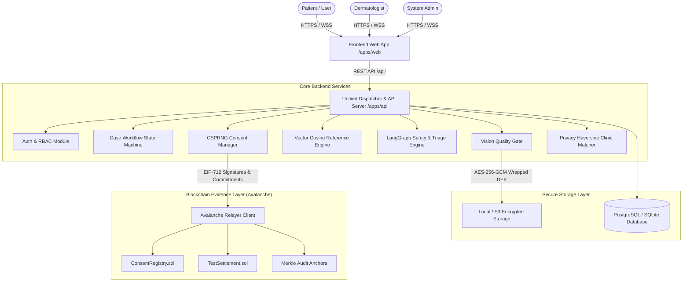
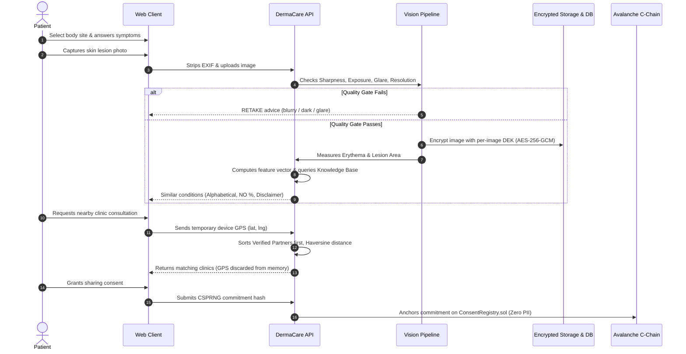

# DermaCare Agent — System Architecture Specification

## 1. System Overview

**DermaCare Agent** is a privacy-preserving system for longitudinal skin condition tracking, computer vision feature measurement, non-diagnostic reference lookup, and consent-controlled clinic referral anchored on the Avalanche blockchain.

---

## 2. The Four Provenance Layers

To guarantee medical transparency and prevent machine learning hallucinations from being mistaken for clinical truth, every data point carries a strict **Provenance Badge**:

1. **AI Measured (`ai_measured`)**: Quantitative features computed directly by deterministic computer vision heuristics (sharpness Laplacian, erythema a* index, lesion area ratio). Never produces a definitive diagnosis.
2. **User Reported (`user_reported`)**: Subjective symptom timelines, onset durations, and red-flag answers provided directly by the patient through structured intake forms.
3. **Clinician Entered (`clinician_entered`)**: Formal clinical scores (IGA, EASI, PASI) and clinical observations entered by verified dermatologists after authenticated review.
4. **Synthetic Data (`synthetic`)**: Clear badge affixed to demo fixtures, calibrated baseline curves, or simulated records to ensure no synthetic sample is ever confused with real human health data.

---

## 3. Data Flow & Zero-PII Guarantee

---

## 4. Cryptographic Envelope Encryption

Images at rest are encrypted using envelope encryption:
- A unique **Data Encryption Key (DEK)** (256-bit AES) is generated for each uploaded image using a CSPRNG (`os.urandom(32)`).
- The raw image is encrypted with `AES-256-GCM`.
- The DEK is encrypted (wrapped) with the application's **Master Key** (`APP_MASTER_KEY`).
- Clinicians accessing the image receive a short-lived (60-second) JWT image token that permits one-time in-memory decryption.

---

## 5. Non-Diagnostic Safety Boundary

- **No Diagnostic Statements**: The system strictly forbids outputting words such as `"bạn bị mắc"`, `"khỏi bệnh"`, `"nặng hơn"`, `"nguy hiểm"`.
- **Zero Percentage Probabilities**: Similar conditions are displayed strictly for educational reference and sorted alphabetically. No percentages or disease ranking scores are exposed to the user.
- **Mandatory Disclaimers**: A persistent banner is permanently fixed across all web views:
  > *"LƯU Ý QUAN TRỌNG: Công cụ tham khảo & theo dõi tiến triển tổn thương da liễu, không phải chẩn đoán y khoa."*
